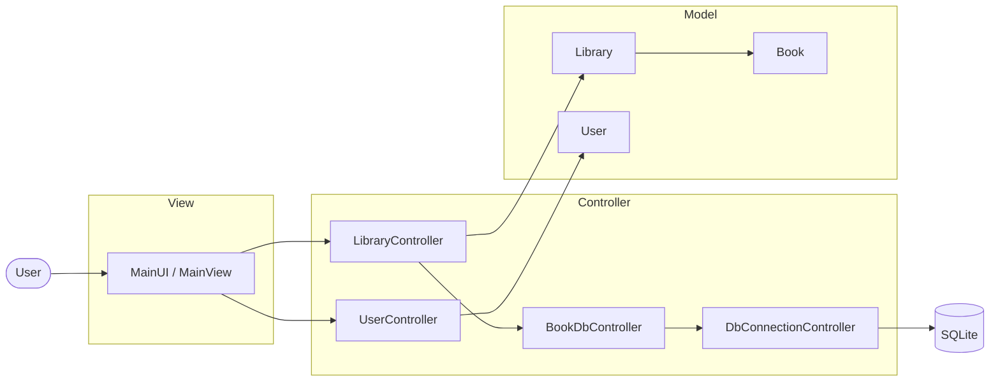
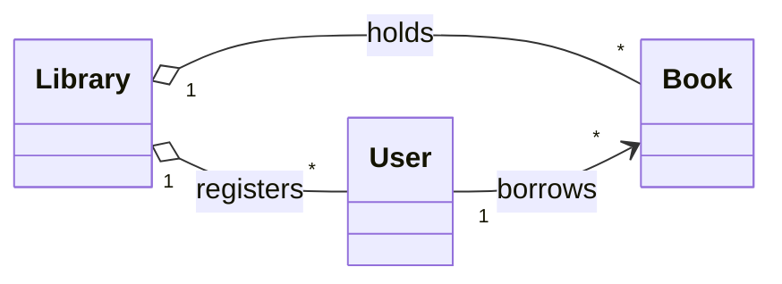
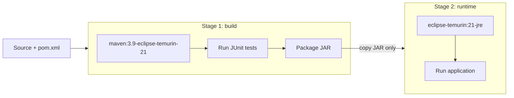

<p align="center">
  
</p>

<p align="center">
  
  
  
  
  
</p>

<p align="center">
  
  
  
</p>

<p align="center">
  <a href="#overview">Overview</a> ·
  <a href="#quick-start">Quick start</a> ·
  <a href="#architecture">Architecture</a> ·
  <a href="#testing">Testing</a> ·
  <a href="#docker">Docker</a> ·
  <a href="#design-decisions">Design decisions</a> ·
  <a href="#roadmap">Roadmap</a>
</p>

---

## Overview

Library System is a console application for managing a book collection, its users and lending operations. It is written in Java 21 using a strict **Model-View-Controller** separation, persists data in **SQLite** through plain **JDBC**, and ships as a multi-stage **Docker** image that runs the full test suite during the build.

The goal of the project was to build a small but complete application the way a production service would be structured: clear layers, SQL isolated from business logic, automated tests wired into the build, and a reproducible runtime.

<table>
  <tr>
    <td align="center"><b>30</b><br><sub>automated tests</sub></td>
    <td align="center"><b>3</b><br><sub>architectural layers</sub></td>
    <td align="center"><b>2</b><br><sub>stage Docker build</sub></td>
    <td align="center"><b>0</b><br><sub>external DB servers</sub></td>
  </tr>
</table>

---

## Features

<table>
  <tr>
    <td width="50%" valign="top">

**Library**
- Add and remove books
- List the full catalogue
- Lend a book to a user
- Return a borrowed book
- View currently borrowed books

</td>
    <td width="50%" valign="top">

**Search and sorting**
- Search by author
- Search by publication year
- Sort by title
- Sort by year

</td>
  </tr>
  <tr>
    <td width="50%" valign="top">

**Users**
- Create and manage users
- Track borrowed books per user
- Tie every lending operation to a user

</td>
    <td width="50%" valign="top">

**Persistence**
- SQLite storage via JDBC
- Dedicated database controllers
- Book availability tracked in the database

</td>
  </tr>
</table>

---

## Quick start

### With Docker

```bash
git clone https://github.com/MIhajloS07/LibrarySystem-Java.git
cd LibrarySystem-Java

docker build -t library-system .
docker run --rm -it library-system
```

The build runs the tests first. If any test fails, no image is produced.

### With Maven

Requires **JDK 21** and **Apache Maven**.

```bash
mvn test       # run the test suite
mvn package    # run tests and build the JAR into target/
```

---

## Architecture

The application is split into three layers. The view never touches the database, and SQL never leaks into business logic.



### Domain model



### Layer responsibilities

| Layer | Classes | Responsibility |
| --- | --- | --- |
| **Model** | `Book`, `User`, `Library` | Domain entities and their state |
| **View** | `MainUI`, `MainView` | Menu, input, output. Delegates everything else to controllers |
| **Controller** | `LibraryController`, `UserController` | Business logic |
| **Persistence** | `BookDbController`, `DbConnectionController` | SQL and connection handling, kept apart from business logic |

Controller contracts are defined as interfaces, which keeps the layers loosely coupled and makes them straightforward to test in isolation.

---

## Data persistence

SQLite was chosen deliberately: it is a real relational database with full SQL support, but needs no server, which keeps the project trivial to run locally and inside a container.

The database stores books, users, lending operations and book availability. All access goes through JDBC and is confined to the persistence controllers.

<p align="center">
  
</p>

### Collection processing

Searching and sorting use the **Java Stream API** instead of hand-written loops, which keeps filtering by author or year, and ordering by title or year, short and readable.

---

## Testing

Tests are written with **JUnit 5** and run automatically as part of the Maven lifecycle.

| Area | Covered |
| --- | --- |
| Model | Entity behaviour |
| Controllers | Business operations |
| Library | Lending and returning flow |
| Database | Persistence operations |

```text
Tests run: 30, Failures: 0, Errors: 0, Skipped: 0
```

```bash
mvn test
```

---

## Docker

The Dockerfile uses a multi-stage build so the final image contains only what is needed to run the application.



| Stage | Base image | Purpose |
| --- | --- | --- |
| Build | `maven:3.9-eclipse-temurin-21` | Compile, run tests, package |
| Runtime | `eclipse-temurin:21-jre` | Run the packaged JAR on a JRE only |

---

## Project structure

```text
LibrarySystemMVC/
├── src/
│   ├── main/java/
│   │   ├── controller/
│   │   │   ├── BookDbController.java
│   │   │   ├── DbConnectionController.java
│   │   │   ├── LibraryController.java
│   │   │   ├── UserController.java
│   │   │   └── (interfaces)
│   │   ├── model/
│   │   │   ├── Book.java
│   │   │   ├── User.java
│   │   │   └── Library.java
│   │   └── view/
│   │       ├── MainUI.java
│   │       └── MainView.java
│   └── test/java/
│       ├── model/
│       └── controller/
├── pom.xml
├── Dockerfile
├── .dockerignore
└── README.md
```

---

## Design decisions

- **SQL isolated from business logic.** Persistence lives in `BookDbController` and `DbConnectionController`, so the rest of the code does not depend on how data is stored. Switching databases means changing one layer.
- **Interfaces for controller contracts.** Layers depend on abstractions, which keeps coupling low and tests simple.
- **Thin view.** The view only reads input and prints results. No business rules live there.
- **Tests gate the build.** Tests run inside the Docker build, so an image can never be produced from failing code.
- **Multi-stage image.** Maven and the JDK stay in the build stage; the runtime image carries only a JRE and the JAR.
- **SQLite over a database server.** The goal was to practise real SQL and JDBC without operational overhead.

---

## Screenshots

<table>
  <tr>
    <td></td>
    <td></td>
    <td></td>
  </tr>
</table>

---

## Roadmap

- [x] MVC architecture with interface-based controllers
- [x] SQLite persistence over JDBC
- [x] JUnit 5 test suite (30 tests)
- [x] Multi-stage Docker build with tests in the pipeline
- [ ] Docker volume for persistent SQLite storage
- [ ] Input validation and improved CLI experience
- [ ] Additional integration tests
- [ ] CI pipeline (GitHub Actions)
- [ ] REST API layer
- [ ] Migration path to PostgreSQL or MySQL
- [ ] GUI client

---

## License

Released under the [MIT License](LICENSE).

<p align="center">
  
</p>

<p align="center">
  <sub>Built by <a href="https://github.com/MIhajloS07">MihajloS07</a></sub>
</p>
